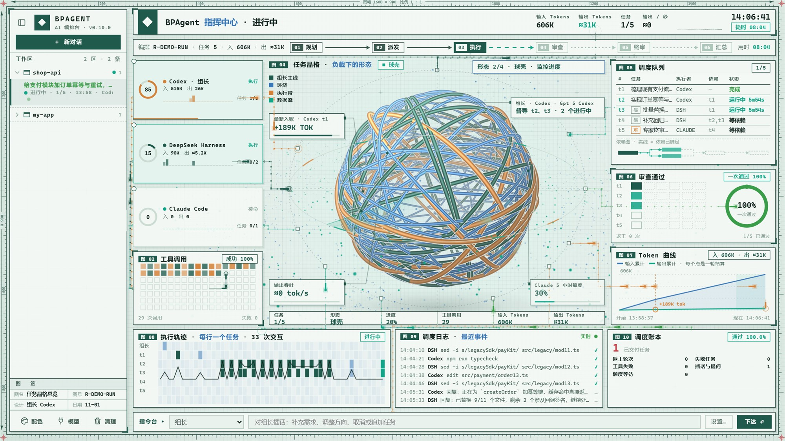
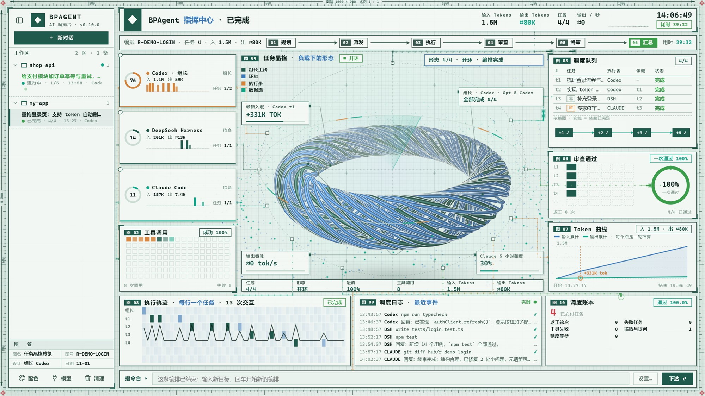
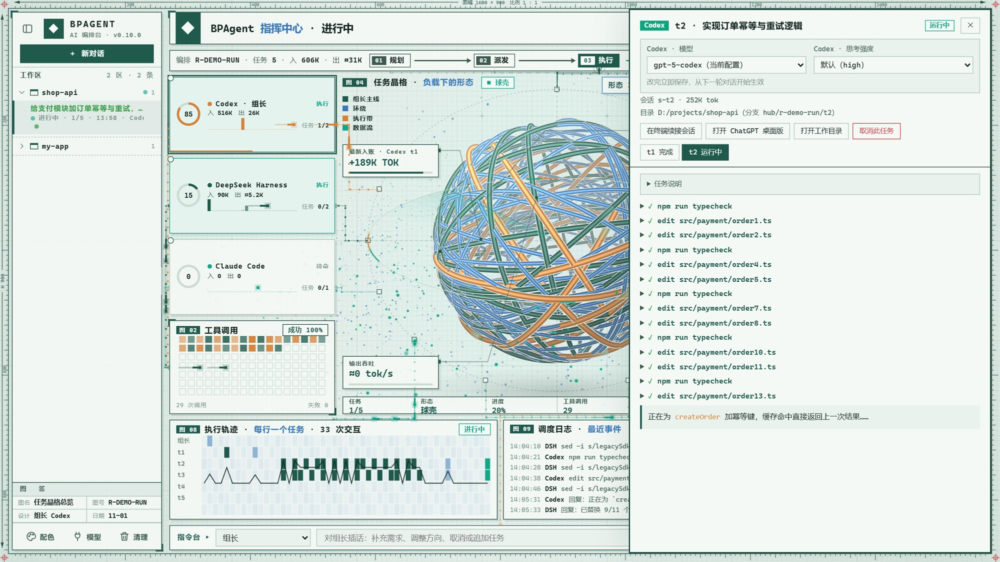

<div align="center">

# BPAgent

**把多个 AI 编程代理编成一支队伍**

组长拆解任务、派活、审查、汇总；队员并行执行。额度只花在刀刃上。

<sub>Multi-agent orchestration console for Claude Code · Codex · DeepSeek Harness</sub>

<br>


<br>



</div>

---

## 为什么做它

单个 AI 编程代理很强，但额度和注意力都是有限的。BPAgent 不再让你在多个 CLI 之间来回切窗口，而是把它们编成一支分工明确的团队：便宜的模型干体力活，主力模型做常规实现，最贵的专家只接疑难问题并做一次终审。你只需要说出目标，剩下的由**组长**去规划、派发、审查、返工，**指挥中心**实时展示整条流水线。

## 核心特性

- **组长 + 队员协作**：组长拆任务、定依赖、逐个审查、必要时返工，最后汇总；队员各自独立会话并行执行，可随时向组长提问。
- **按档位分工，省专家额度**：经济型（DeepSeek）做机械活，主力（Codex）做常规实现，专家（Claude）只接难题并做一次整体终审。
- **额度用尽自动等待**：Claude 额度触顶时按恢复时间封锁，在跑的任务原地等待，到点续接原会话，不惊动组长。
- **worktree 隔离并行**：每个任务在独立的 git worktree 里做，通过后合并回集成分支；冲突会交回队员解决。
- **实时指挥中心**：任务晶格、调度队列、Token 曲线、工具调用、执行轨迹和调度日志，一屏看清谁在做什么；点任意节点可看实时输出，也可随时插话。
- **自定义模型**：任意反代 / 中转站（Anthropic Messages、OpenAI Responses、Chat Completions）都能接入，套在现成的 CLI 上跑。
- **中断续跑**：编排被中断或失败后，可以用原会话继续运行。
- **零依赖**：Node 20+ 即可运行，配置是热加载的 JSON，新增一个 AI 不用改代码。

## 界面一览

<table>
<tr>
<td width="50%"><br><sub><b>编排完成</b>：任务、审查、Token 与调度账本一目了然</sub></td>
<td width="50%"><br><sub><b>任务抽屉</b>：实时输出、工具调用、切换模型与思考强度</sub></td>
</tr>
</table>

## 启动

**桌面应用（推荐）**：第一次运行 `launcher\install.ps1`（右键 →「使用 PowerShell 运行」），会在桌面和开始菜单建好「BPAgent」快捷方式。之后双击图标：

- 后台启动服务（没有黑窗口），并用本机 Edge 的应用模式打开独立的「BPAgent · 指挥中心」窗口。这个窗口有单独的用户目录，不会和日常浏览器混在一起。
- 托盘常驻：左键打开窗口，右键菜单有显示指挥中心、数据目录、服务日志、重启服务、退出。关掉窗口后服务仍在托盘运行。
- 已经在运行时再双击，只会把窗口提到前面。服务意外退出时，托盘会自动把它拉起来。
- 退出时，如果有编排正在进行会先提示。退出会把它们标记为中断，下次可以「继续运行」。
- 命令行方式：`launcher\BPAgent.vbs -NoWindow` 只启动服务和托盘，`-Quit` 让正在运行的那一份退出。卸载快捷方式：`launcher\install.ps1 -Uninstall`。

**调试 / 网页版**：双击 `start.cmd`。服务就绪后它会自动用默认浏览器打开 http://127.0.0.1:7788 ；如果托盘那一份已经在跑，就直接打开现有的。弹出的黑窗口就是服务本身，关掉它编排台就停了（网页上下达指令会提示失败）；不要在黑窗口里点选文字，Windows 的快速编辑模式会冻结输出、卡住服务，误点了按 Esc。也可以直接 `node src/server.js [--open]`。

需要 Node 20+，无第三方依赖。

首页是**指挥中心**（v0.3.0 起）：组长是中央核心，每种 AI 一个节点排在周围。运行中的节点变黄，并持续向核心输送粒子；额度用尽变红，显示倒计时环；待审查显示白环。左侧是舰队总览和成员状态，右侧是调度队列、各 AI 的 Token、实时遥测。点核心、节点或任务行，右侧会弹出抽屉显示实时输出；在成员状态里点某个 AI，看的是它本身：模型、它的任务，Claude 还会显示订阅额度。额度和命令行 claude-hud 显示的是同一份数据：claude-hud 配置了 `display.externalUsageWritePath`，编排台读取它写出的快照，路径可以在 `config/hub.json` 的 `claudeUsageFile` 里改。底部的**指令台**有编排在跑时可以对组长或单个队员插话，没有时输入目标、回车，会弹出新建框（焦点在「开始」上，工作目录留空会自动新建），再回车就开跑。v0.7.0 起去掉了旧的看板视图，只保留指挥中心；启用 / 停用某个 AI 在成员状态里点它，抽屉里有按钮。

**切换模型**：点任意 AI 的节点、成员状态行或核心，抽屉顶部有「模型 / 思考强度」下拉框。改完立即写回 `config/agents.json`，从下一轮对话开始生效。正在跑的会话也一样，当前这一轮不会被打断。候选项来源：Claude 是 opus / sonnet / haiku；Codex 读 `~/.codex/models_cache.json` 和 config.toml；ACP（dsh 等）用会话自报的 configOptions，还没跑过任务时会临时开一个会话问一下，不发提示词。

## 用法

1. **新建编排**：写目标，选组长和队员、审批方式（全自动 / 每次都问我）、隔离方式、返工上限、并行数。也可以先选一个**模板**一键填好，当前设置也能「存为模板」。工作目录留空时：目标里写了已存在的目录（例如 `"D:\projects\my-app"，优化登录页`），就直接用它当工作目录；否则自动建一个空目录 `%USERPROFILE%\AgentHub\workspaces\<编排id>`（v0.10.0 前不识别目标里的路径，AI 会在空目录里干活）。
2. 组长先规划，任务在右侧调度队列里按「待开始 → 进行中 → 组长审查 → 已结束」流转，标着执行者和难度（难 / 易 / 终审）。
3. 点任务行、节点或中央核心（组长），右侧显示实时事件流，包括发给它的指令、思考、工具调用及结果、回复。
4. **队员遇到阻塞可以问组长**：队员拥有 `ask_leader` 工具（Claude 经 MCP 配置，Codex 用 `-c mcp_servers.hub`，ACP 走 session 的 mcpServers）。问题排进组长的队列，组长回答后原样返回给队员，队员接着做，遥测里能看到这一问一答。
5. **随时换组长**：在组长抽屉里可以改模型，从下一轮开始生效；也可以把组长换成另一个 AI，它会在当前这一轮结束后接手，交接时附上目标、拆分思路和任务进度。
6. 运行中可以在下方**对组长说话**：补充需求，让它追加或取消任务。在指挥中心也可以选某个队员插话：队员的一轮对话中途插不进去，消息会在它下一轮开头送达；如果本轮已经交付，组长审查时会看到这条消息，据此决定是否返工。
7. 审批模式选「每次都问我」时，顶部会出现审批条，可以在这里允许或拒绝。
8. 「在终端续接会话 / 打开 DSH 桌面版 / 打开工作目录」可以打开 AI 的原生界面。

## 分工：Claude 额度只花在刀刃上（v0.7.0）

只订了 Claude Pro 时，额度是最稀缺的资源。参考社区的普遍做法（Claude 负责规划、审查和疑难问题，Codex 负责落地实现，DeepSeek 便宜、适合批量和机械活），编排台按**档位**分工，agents.json 里每个 AI 有一个 `tier`：

| 档位 | 默认是谁 | 干什么 |
|---|---|---|
| 主力 `main` | Codex（GPT） | **默认组长**：规划、逐个审查、汇总；常规功能实现、重构、普通 bug、跑测试修测试 |
| 经济型 `cheap` | DeepSeek（dsh） | 机械改动、批量替换、写文档和注释、补测试用例、收集资料、Office 文件 |
| 专家 `expert` | Claude | 只接 `hard` 任务：架构 / 接口设计、跨模块疑难 bug 定位、并发 / 性能 / 安全问题、别人失败过的问题；全部完成后做**一次**整体终审 |

组长给每个任务标 `level`（easy / normal / hard），按档位派活。职责会按实际情况动态调整：

- **额度感知**：组长规划时能看到 Claude 当前的 5 小时 / 7 天用量。用量达到 `routing.tightAt`（默认 70%）时，提示组长尽量别用 Claude，派给它的非 hard 任务会被编排台**自动改派**给主力或经济型队员。真用尽时 hard 任务原地等恢复（原有的额度等待机制）。
- **强模型按需开**：Claude 默认用 Sonnet。hard 任务在用量低于 `routing.strongModelBelow`（默认 50%）时自动换成 `claude.hard` 里的模型（默认 Opus + high），否则仍用 Sonnet，只提高思考强度。
- **自动终审**：全部任务完成后，编排台追加一个「专家终审」任务，让 Claude 一次性审查整体 diff：小问题顺手修，大问题列出来，组长再派给 Codex / dsh 修。用量超过 `routing.finalReviewSkipAt`（默认 85%）、没有改动或成果全是 Claude 自己做的时候会跳过。新建框里可以关掉。
- **失败升级**：任务因为能力问题失败时，组长可以换给更高档位的队员重试。
- **调用瘦身**：Claude 每次调用默认走精简模式（`claude.lean`）：不加载技能清单（`--disable-slash-commands`），只给必要的内置工具（组长只读：Read / Grep / Glob / PowerShell；队员再加 Edit / Write），关掉自动记忆。实测每轮固定开销从约 2.8 万 token 降到约 7 千。需要更多工具时在 `claude.tools.leader / member` 里写逗号分隔的工具名。
- 想让 Claude 当组长也可以，但规划、每个任务的审查和汇总都会消耗额度，新建框会提示。额度紧张时可以用模板「不用 Claude」。

`config/hub.json` 的 `routing` 里可以改这三个阈值。

## 组长的决策

| 场景 | 组长可选 |
|---|---|
| 队员交付 | accept 通过 / revise 返工（不超过返工上限）/ 追加新任务 |
| 专家终审 | 直接 accept，把终审列出的严重问题追加成修复任务派给其他队员 |
| 队员失败 | retry 重试（可以换人，最多 2 次）/ skip 跳过 |
| 用户插话 | 回复，并追加或取消未开始的任务 |

遇到上游临时故障（429、5xx、限流、断连），编排台会先自动退避重试 2 次（间隔 15 秒、30 秒），仍然失败才交给组长处理。

## 额度用尽：自动等待、恢复后续跑

Claude 的 5 小时或 7 天额度用尽时，编排台会根据 Claude 返回的恢复时间：

- **封锁这个 agent**：顶栏显示“额度用尽 · HH:MM 恢复”，期间不再给它派新任务。待开始的任务在调度队列里显示“额度等待”。
- **正在跑的任务和组长原地等待**，不算失败，也不惊动组长。到点后续接同一个会话，并附上“刚才因额度中断，先检查已完成的部分再继续”的说明。
- 到点自动解封，并重新调度所有编排。

在 agents.json 里给 agent 加 `"quotaPause": 0.95` 后，5 小时用量达到 95% 就会暂停派新任务（在跑的任务不受影响），避免任务做到一半被额度打断。

## worktree 隔离

隔离方式选「自动」时：工作目录是 git 仓库或空目录，就用 worktree；否则用共享目录。

- 每个编排有一条集成分支 `hub/<编排id>`。每个任务在自己的 worktree（`%USERPROFILE%\AgentHub\worktrees\<编排id>\<任务id>`）里并行做，互不干扰。
- 组长验收后，编排台提交该任务的改动并合并进集成分支，后续任务基于最新的合并结果开工。
- **合并冲突**：编排台把集成分支反向合进队员的工作区，冲突标记留在文件里，任务带着说明交回原队员解决，最多 2 次。
- 编排结束时：工作目录是自动新建的，就自动合并回去；是你自己的仓库，就不动你的分支，需要你点「合并到工作目录」（要求工作区没有未提交的改动）。
- 如果你的仓库有未提交的改动，队员看不到这些改动，编排开始时会提醒。

## 工作区与残留清理

编排台会在磁盘上留下这些东西（目录位置在 `config/hub.json` 的 `workspaceRoot` / `worktreeRoot`）：

| 东西 | 位置 | 什么时候清掉 |
|---|---|---|
| 自动工作目录 | `%USERPROFILE%\AgentHub\workspaces\<编排id>` | 删除这条编排记录时一起删 |
| 任务 worktree | `%USERPROFILE%\AgentHub\worktrees\<编排id>\<任务id>` | 任务通过 / 取消时拆掉 |
| 集成工作区 | `...\worktrees\<编排id>\_main` | 合并后拆掉；取消的编排会留着 |
| 分支 `hub/<编排id>*` | 工作目录所在的仓库 | 合并后删；没合并的保留，方便手动合并 |
| 临时 MCP 配置 | `data\tmp\mcp-*.json` | 会话关闭时删 |

侧栏底部的「清理」会先列出所有残留，确认后一次删掉：没有编排记录的自动工作目录、已结束编排没拆掉的 worktree、记录已删的编排留在你仓库里的 `hub/` 分支、临时文件。进行中和可以继续运行（已中断 / 失败）的编排不会动。你自己的工作目录永远不删。

## 自定义模型（接反代 / 中转）

侧栏底部「模型」→「新增模型」，填名称、接口协议、请求地址、API Key、模型名（「获取列表」会请求反代的 `/models`，也能顺便测试通不通）。编排台不会另写对话循环，而是把模型套在现成的 CLI 上跑，工具调用、改文件、续接会话、`ask_leader` 都照常可用：

| 接口协议 | 可选驱动 | 说明 |
|---|---|---|
| Anthropic Messages | Claude Code / DeepSeek Harness | Claude Code 通过 `ANTHROPIC_BASE_URL` + `ANTHROPIC_AUTH_TOKEN` 接入，不占 Claude 订阅额度 |
| OpenAI Responses | Codex / DeepSeek Harness | Codex 用 `-c model_providers.*` 临时挂一个 provider，不改 `~/.codex/config.toml` |
| OpenAI Chat Completions | DeepSeek Harness | Codex 0.16x 起不支持 chat 协议，只能用 dsh（pi-ai 内核）驱动 |

地址只填域名就行：Anthropic 会去掉末尾的 `/v1`，OpenAI 只填了域名时会补上 `/v1`。条目写进 `agents.json`（`custom` 字段），API Key 单独存进 `config/secrets.json`（已加入 `.gitignore`）。dsh 驱动会在 `data\custom\<id>.patch.yml` 生成 provider 配置。

## 中断续跑

服务重启后，没跑完的编排会标为「已中断」；组长出错失败的编排也一样。点「继续运行」后：

- 交付了还没审查的任务重新交给组长审查；干到一半的任务重新派发。
- 能续接原会话就续接（Claude 用 `--resume`，ACP 用 `session/resume`），续不上就开新会话，并提示队员“工作区里可能已有部分成果”。
- worktree 和其中的半成品都会保留。

## 模板

模板存在 `config/templates.json`，内置五个：标准分工（推荐）、不用 Claude（额度紧张时）、疑难问题（Claude 定位）、调研 + 写文档、批量改动（dsh 主力）。模板里的「团队约定」会作为必须遵守的规则写进组长的规划提示词。

## 配置

- `config/agents.json`：队员注册表，**热加载**，直接改文件即可。指挥中心里可以切换模型、启用 / 停用。
- `config/hub.json`：端口、默认工作区和 worktree 目录、新建编排的默认参数（默认组长、是否终审等）、分工阈值 `routing`。
- `config/templates.json`：任务模板（网页上可以存、可以删）。
- `config/dsh-relay.patch.yml`：dsh 走中转站的模型配置（acp profile 默认走官方通道），用前把 `baseURL` 换成你自己的中转站，key 放环境变量 `RELAY_API_KEY`。
- **环境变量**：`DSH_HOME` 指向 DeepSeek Harness 的安装目录（`agents.json` 里 dsh 的启动命令用它拼路径，不用 dsh 可以忽略）；`RELAY_API_KEY` 是 dsh 走中转站时用的 key。

### 接入新的 AI

在 `agents.json` 里加一项即可，不用改代码：

- **反代 / 中转站上的模型**：用网页上的「模型」对话框添加，见「自定义模型」。
- **支持 ACP 的 CLI**（codex-acp 等）：`"type": "acp"`，`command` 和 `args` 填它以 ACP stdio 模式启动的命令。
- **Claude Code**：`"type": "claude"`，使用 `claude -p --output-format stream-json`，并通过 `--resume` 串联同一个会话。
- **Codex**：`"type": "codex"`，使用 `codex exec --json`，并通过 `codex exec resume <id>` 串联同一个会话。默认用的是 ChatGPT（Codex）桌面版自带的 CLI，模型、中转、沙箱和审批都沿用 `~/.codex/config.toml`，所以编排台的「每次都问我」对它不生效。可选字段 `codex.model` / `codex.profile` / `codex.config`（会变成 `-c key=value`）。

常用字段：`tier`（cheap / main / expert，见「分工」）、`roles`（leader/member）、`maxConcurrent`（全局并发上限）、`env`/`unsetEnv`（支持 `${env:A|B}` 和 `${root}` 占位）、`native`（打开原生界面的命令，可用 `{cwd}` `{sessionId}` `{title}` `{command}`，其中 `{command}` 是解析后的可执行文件路径）。`command` 支持 `${env:..}`，绝对路径的目录名里可以写 `*`（例如 `${env:LOCALAPPDATA}\OpenAI\Codex\bin\*\codex.exe`，桌面版升级后目录名会变），多个命中时取最新的。

## 结构

```
launcher/            桌面入口：BPAgent.vbs（无窗口启动）→ BPAgent.ps1（托盘宿主：起服务、开独立窗口、单实例）；install.ps1 生成图标和快捷方式
src/server.js        HTTP + SSE，只监听 127.0.0.1，校验 Host 头
src/orchestrator.js  编排状态机：规划 → 调度 → 审查 → 汇总；额度等待、续跑、worktree 合并
src/git.js           worktree / 提交 / 合并 / 冲突检测
src/templates.js     任务模板存取
src/adapters/acp.js     通用 ACP 客户端（dsh 等）
src/adapters/claude.js  Claude Code 流式适配器
src/adapters/codex.js   Codex（codex exec --json）适配器
src/custom.js        自定义模型：展开成 Claude Code / Codex / dsh 的启动配置，密钥存取，拉 /models
src/hub-mcp.js      给 AI 用的 MCP 服务：approve（Claude 的 --permission-prompt-tool）、ask_leader（队员向组长提问）
src/models.js       切换模型：各类 agent 的可选模型 / 思考强度，写回 agents.json
src/registry.js      agents.json 热加载 + 运行状态 / 额度
src/usage.js         Claude 订阅额度（claude-hud 快照 / rate_limit_event）
src/store.js         data/runs/<id>/run.json + events.jsonl
web/                 前端（原生 JS）：index.html + command.js + command.css 指挥中心；common.js 通用部分（事件渲染、新建对话框）；settings.js 自定义模型和清理残留对话框
```

## 已知限制

- dsh 在带有特殊 ACL 的目录下工作时，会先自动修复沙箱权限，审批模式为「每次都问我」时会弹一次审批。
- dsh 在 worktree 里偶尔会不听要求，自己执行 git commit。worktree 的 git 元数据在仓库的 `.git` 目录下，超出它的沙箱范围，所以会多一次提权审批。编排台的合并逻辑兼容它自己提交的情况。
- 额度用尽的识别基于 Claude Code 的 `rate_limit_event` 和错误文本，这部分是用模拟数据验证的，真实触顶时如果提示文字不同，请把 `data/runs/<id>/events.jsonl` 发给我调整。
- 测试用的隔离实例：`HUB_PORT / HUB_DATA / HUB_AGENTS / HUB_WORKSPACES / HUB_WORKTREES` 环境变量可以覆盖对应配置。
- dsh 的 `dsh://` 深链只能把桌面版调到前台，不能直接定位到某个会话。
- Token 统计：Claude 用 `result.usage` 的真实值（含缓存读写）。ACP（dsh 等）没有逐轮用量，输入取上下文占用，输出按流式字数估算，界面上标 `≈`。底部 tok/s 一律是按字数做的估算。
